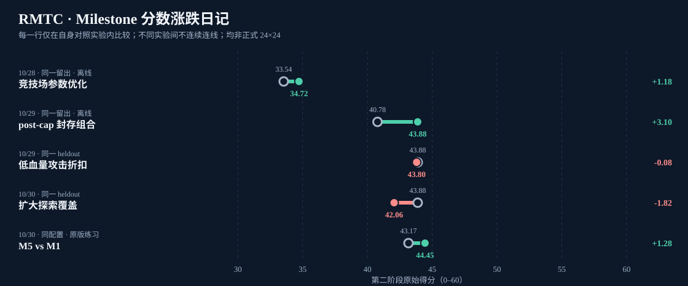
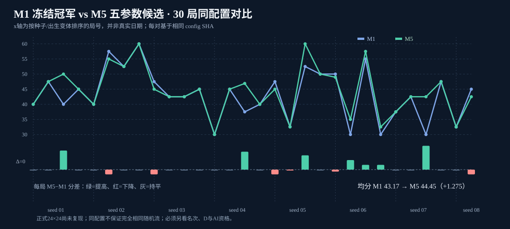

# RMTC · Milestone 研发日记

> **唯一继续维护的记录入口**：比赛代码仓库 `strategy/iterate-arena-2026-10-28` 分支下 `milestones/`。旧 `strategy/visible-resource-bfs` 不再作为我们的提交目标，保留不删；研究仓库 `ANALYSIS/COMPARISON` 和 `log` 中既有资料按 SHA 引用，不在其上新增本项目的日记提交。\
> 数据截止：**2026-10-30 21:00 北京时间**；已验证最新日志快照 `log@2dffdcb6d8cf`。记录不等于比赛的唯一真值；各项归因强度单独标注。



上图 **每行只连接同一对照下的基准和候选**；并不连接不同地图、不同裁判或不同对手池的分数。红色回落不是失败的耻辱，而是我们实际排除掉了一个错误方向。图中的 10/28、10/29、10/30 是**实验研究日期**；`20261201` 等是未来形式的**随机种子编号，并非发生日期**。

## 每个 Milestone 都记录什么

日期 / 想法及问题 → **被修改的代码提交 SHA** → 冻结参数/二进制 SHA → 所用地图、地图尺寸、对手池与裁判类型 → 对照实验 seed / 席位 / n → R、D、M、总分、rank1、死亡与无效动作 → 预注册目标 → 实测差值 → **采纳 / 否决 / 待验证** → 后续复盘。

**请特别警惕四种混淆**：`merge/docs` 提交不是新策略代码；不同实验系列的分数不能连线；单场最高分不能替代均分/名次；终局 HP=100 或 `deaths=0` 汇总字段不代表整场真的零死亡。完整死亡次数要从裁判逐 Tick `alive=true→false` 边沿独立计算（新192/M5归档缺完整 `frames.jsonl`）。

## Milestone 时间轴：每次有证据的升降都保留

| 日期 / Milestone | 做了什么、代码证据 | 同条件或实际结果 | 裁决 / 事实边界 |
| --- | --- | --- | --- |
| **10/27 · 规则状态机** | 规则v1.2、行为合法性与统一配置；参见[正式规则解析](https://github.com/Frank-678/The-Logical-Structure-of-RMT-C/blob/ANALYSIS/docs/16-v1.2-rule-migration.md) | 尚没有可比的联赛分数 | 研发基础完成，不能画“提升” |
| **10/28 · 多风格离线竞技场** | [代码 4c76761](https://github.com/Frank-678/RoboMaster-Turing-Competition-BeyondControl/commit/4c7676159be4b35dded9f41a473ca5a2e8530ad6)；资源串深度3→4、任务机会与到点权重调整、治疗HP阈值70→40、受阻改道开启 | 同一留出 stage2 均分 **33.54→34.72（+1.18）**；stage1 **32.33→32.33**；阻塞1178→282，死亡81→89 | **阶段采纳**；是离线自建裁判，且多个参数同时改，不可将+1.18归因到单参数。[证据](https://github.com/Frank-678/The-Logical-Structure-of-RMT-C/blob/ANALYSIS/docs/24-multistyle-arena-tuning-and-gateway-2026-10-28.md) |
| **10/29 · 首场完整真实 LLM/DDS 练习** | [原始对局分析](https://github.com/Frank-678/The-Logical-Structure-of-RMT-C/blob/ANALYSIS/docs/28-first-real-llm-dds-battle-2026-10-29.md)；[本场 log 数据](https://github.com/Frank-678/The-Logical-Structure-of-RMT-C/blob/log/practice-15465a23820b43d0b277d0f1de7fc655/score.json) | A 得 **40/60，R40，D845，M3，第3名，12次死亡**；LLM 30/30 成功 | **问题基线**：开盘资源丢失+站桩对射；单场不足以推测平均性能 |
| **10/29 · post-cap 同分伤害** | [冠军冻结提交 eb321df](https://github.com/Frank-678/RoboMaster-Turing-Competition-BeyondControl/commit/eb321df03d46d8e05fe7ccc762a76389a4111a88)；默认启用 `post_cap_combat_weight=0.02`，而默认 `race_reach_holdoff=0` | 离线30个 heldout 同场景组合对照：stage2 **40.78→43.88（+3.10）**，stage1 **32.33→32.67** | **保留冻结冠军**；对照是“封存组合 vs 旧baseline”，不能把3.10全归给单独`post_cap`。[证据](https://github.com/Frank-678/The-Logical-Structure-of-RMT-C/blob/ANALYSIS/docs/29-review-fixes-and-postcap-lever-2026-10-29.md) |
| **10/29 · 低血量进攻折扣** | `low_hp_attack_discount`：测试0.7/0.4/0.1，选0.4，试图减少临死攻击；[实验设计与结果](https://github.com/Frank-678/The-Logical-Structure-of-RMT-C/blob/ANALYSIS/docs/34-lowhp-attack-discount-2026-10-29.md) | 同一30场heldout：冠军 **43.88**，折扣0.4为 **43.80（−0.08）**；objective0.8298625→0.8286479 | **预注册否决**，恢复默认1.0；避免因“死得多”盲目全局保守 |
| **10/29 · 资源优先、推迟到点** | `race_reach_holdoff=0.8/1.0`，仅改“资源/任务”之间的排序；[赛车批次](https://github.com/Frank-678/The-Logical-Structure-of-RMT-C/blob/ANALYSIS/docs/37-race-batches-real-battles-2026-10-29.md) | 18×18原版练习跨批对照，均分 **42.50→45.36→45.94**（0/0.8/1.0）；但 **t30任务完成率0.306 < 预注册0.356**；有一次 R120/D1155/M3/60满分 | **预注册不晋升**，保持0；不同批次的均分方向是线索而非严格配对因果 |
| **10/29 · 16场新版裁判驱动试点** | 旧驱动有串场风险，合并驱动重新跑；[数据归档](https://github.com/Frank-678/The-Logical-Structure-of-RMT-C/blob/log/batch-2026-10-29-league-pilot-new/README.md)，[报告](https://github.com/Frank-678/The-Logical-Structure-of-RMT-C/blob/ANALYSIS/docs/45-newpath-16-game-evidence-2026-10-29.md) | 16局冠军均分 **44.8438**，R60.62、D1189.42、rank1 **7/16**；M2对旧冠军同场 **5胜1负2平**，均差+2.1875但bootstrap区间跨0 | **无晋升主张**；此16场与上面离线30场/不同测试池不能接成同一趋势线 |
| **10/29 · 96场规模化中止** | [计划护栏与原始日志](https://github.com/Frank-678/The-Logical-Structure-of-RMT-C/blob/log/batch-2026-10-29-scale-96-partial/README.md)，[审查](https://github.com/Frank-678/The-Logical-Structure-of-RMT-C/blob/ANALYSIS/docs/47-scale-96-partial-league-2026-10-29.md) | **12/96有效**，冠军均分 **43.9583**、rank1 6/12；其余受修改工作树触发 SHA 守卫而未开始 | **有效局保留，未开赛不补零**；不把“计划96局”写作“完成96局” |
| **10/29–10/30 · 扩大探索覆盖试验** | `explore_component_value`：希望走向更大未知区域；[实验报告](https://github.com/Frank-678/The-Logical-Structure-of-RMT-C/blob/ANALYSIS/docs/32-lc-coverage-exploration-2026-10-30.md) | 同30场heldout，同一冠军 **43.88**，候选 **42.06（−1.82）**，资源收益未复现、排名比例变差 | **否决**、默认0；是“探索过远会错过资源/陷入拥堵”的反面经验 |
| **10/29–10/30 · R2与版本冻结** | [M3五参数候选代码38b5d09](https://github.com/Frank-678/RoboMaster-Turing-Competition-BeyondControl/commit/38b5d09b9742642e6cc0f24f4ea9724007dbe1b4)；[候选差分研究](https://github.com/Frank-678/The-Logical-Structure-of-RMT-C/blob/ANALYSIS/docs/46-r2-candidate-comparison-2026-10-29.md)，[预注册](https://github.com/Frank-678/The-Logical-Structure-of-RMT-C/blob/ANALYSIS/docs/48-league-192-m3-freeze-amendment-2026-10-29.md) | `mev2,pcc0,rmb4,rmv4,grb0.1`；排除默认关闭的`tactical_search`之死参数`tdc` | **候选冻结但不是冠军晋升**；五参同时差异，因果拆分需单参消融 |
| **10/30 · 192场四混合联赛** | [完整归档](https://github.com/Frank-678/The-Logical-Structure-of-RMT-C/blob/log/league-192-2026-10-30/league_summary.json)，[代码提交核对](https://github.com/Frank-678/RoboMaster-Turing-Competition-BeyondControl/commit/06f3dcd527c8)，[收批报告](https://github.com/Frank-678/The-Logical-Structure-of-RMT-C/blob/ANALYSIS/docs/52-league-192-results-and-stage2-evidence-2026-10-30.md) | M1冠军 vs 原版48局均分 **43.96**；M2冠军 vs 旧冠军48局 **44.22**；M3冠军 vs 候选48局 **43.49**；M4候选 vs 冠军48局 **43.96** | **四种对手池不同，不能串成“分数随版本涨跌”**；192场AI调用3640/3640失败，测得本地规则引擎表现而非正式AI资格 |
| **10/30 · M5同池同配置对照** | 同A席、同三原版陪练与配置 SHA 的 [M1](RUN_INDEX.md#m1冠军-vs-三原版)/[M5](RUN_INDEX.md#m5候选-vs-三原版目前3048)，A程序由 [冠军eb321df](https://github.com/Frank-678/RoboMaster-Turing-Competition-BeyondControl/commit/eb321df03d46d8e05fe7ccc762a76389a4111a88) → [五参候选38b5d09](https://github.com/Frank-678/RoboMaster-Turing-Competition-BeyondControl/commit/38b5d09b9742642e6cc0f24f4ea9724007dbe1b4) | **30对**：M1同子集均分 **43.17**、M5 **44.445（+1.275）**；R+3.67、D−418.27；**7增、6减、17持平** | **候选未晋升**；M5顶层summary仍24、逐图归档30/48；同配置不能完全保证随机流严格相同。[全对照图](paired_M1_M5.svg) |
| **10/30 · 提前2–5 Tick风险回看** | [审计脚本](https://github.com/Frank-678/RoboMaster-Turing-Competition-BeyondControl/commit/852224f5f12bdb5352f94cc6e25e3af9069fe58d)；[14k Tick法证](https://github.com/Frank-678/The-Logical-Structure-of-RMT-C/blob/ANALYSIS/docs/55-champion-14000-decision-and-2-to-5-tick-causal-audit-2026-10-30.md) | 原版含frames的28局已检查14,000 Tick和222次死亡；新222场预备逐Tick审计脚本，未声称全部反事实证明 | **待原版裁判同状态重放**；不能把`defend→attack`切换数当死亡数 |
| **10/30 · 正式地图适配** | [20×20 practice1](../practice1) + [24×24 practice2](../practice2)，并有[配置校验器](../tools/formal_practice_check.py) | 资源16份价值200，两阶段标准100/500 Tick；原版裁判二进制 **尚未对正式尺寸跑通** | **实测待办**；98/100是非官方双阶段训练目标，不是已有成绩 |



### 关键结论

1. **每次修改有来由，但未必值得晋升**：低血量折扣和扩大探索覆盖都有合理动机，却在正确的基准上失败；应保留这些负结果而不是在下一轮重新试一遍。
2. **最新候选的均分上升不能掩盖对抗不足**：M5 seed04-v2 D480、seed06-v0 D465；在正式24×24“后补伤害”可能更困难；M5也有 seed05-v2 满分60正例。
3. **追踪比赛应落实到会话/配置/代码三重身份**，不能按“Git提交日期相近”把两件事强行绑为同一因果。
4. **每次报告三组指标**：主指标是最终分数+排名/晋级率；中介变量是资源R、有效伤害D、任务M；防护指标是死亡、非法动作、AI资格、决策时延及测试环境完整性。没有真实`frames`的对局将死亡记录为“未知”，不是0。

## 单局可追溯性：现在已有222局

- [完整222局可点开的日志索引](RUN_INDEX.md)——**每局**都有原版 `summary_M*_seed.json`、`botA.log`、`config_v.json`、当时 A 所用源码提交。
- [机器可读场次登记册](match_registry.csv)——222行，每行包含 session、配置 SHA、二进制 SHA、规则字段及链接。
- [M1/M5的30局分数波动图](paired_M1_M5.svg)——只比较同配置、同焦点席、同对手池的这30组；其他联赛混合在各自组别保留。

**重要**：代码版本提交是 source identity，`log@2dffdcb6d8cf` 是目前已验证的归档快照提交，并非每局最初上传时的历史提交。以后新增记录优先查询 GitHub 的“首次包含该归档路径的提交”或收批标注，并同时记录 replay 哈希，保持这两种提交概念不同。

## 每次开发完成后的追加模板

```md
### YYYY-MM-DD HH:MM · Milestone MX — [这一轮解决的问题]
问题/失败 Tick： 
方案与唯一改动点（不是“优化算法”四个字）：
代码提交 / 参数哈希 / 可执行二进制 SHA：
实验来源：原版practice或自建arena / 实际地图宽高 / 对手版本 / 席位 / 真实AI资格：
预注册对照：baseline SHA、地图+资源+事件 seed、n、失败局是否含在分母：
实测：基线score/R/D/M/rank1/deaths → 候选score/R/D/M/rank1/deaths：
差异：绝对分、名次、D封顶成功率/资源时间线以及95%区间（适用时）：
事实与解释：观察事实；待验证机制；可反驳的反例：
判定：采纳 ✅ / 拒绝 ❌ / 待验证 ◐（说明采用哪一条判据）：
复现实物：log相对路径 + summary/frames/原始bot log + 具体commit URL：
回退与下一步：
```

**更新约定**：新的原始比赛日志依旧由既有的 `log` 分支持有人继续归档；我方所有新日记、图表、代码、评审及后续登记更新**只提交到 `strategy/iterate-arena-2026-10-28`**。不修改 `main`、`ANALYSIS`、`COMPARISON`、`strategy/visible-resource-bfs` 或原版 `practice/`。将旧分支视为历史快照，不删除。日记页的图、分数和结论要和追加时所用 log SHA 同步，以免读者把逐步增长的批次当成成绩提升。
